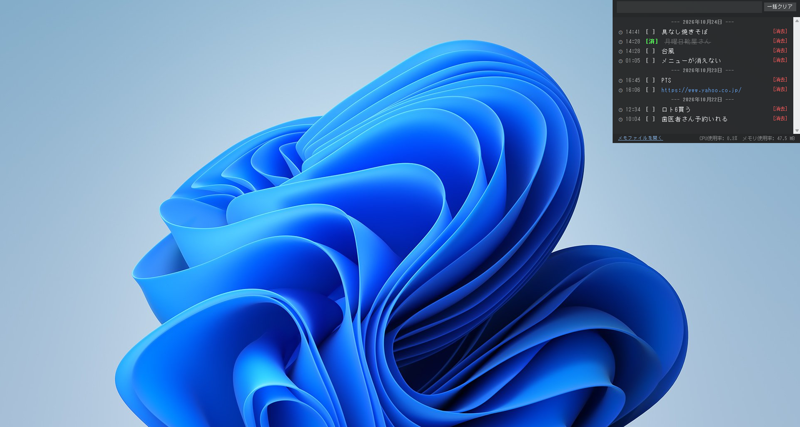
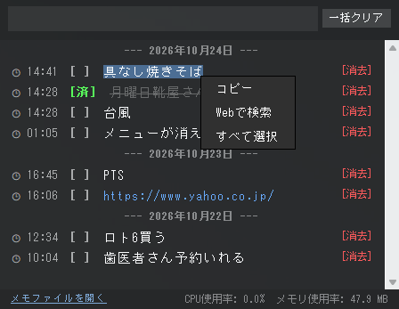
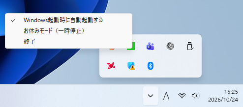

# 隅っこメモちゃん（SumiMemoChan）

**株道経済研究所 制作**

Windowsの画面の隅に常駐する、シンプルで軽量な、作業の邪魔にならないメモ・ToDoアプリです。

マウスカーソルを画面右上の隅に移動するとメモ画面が表示され、カーソルが離れると自動的に非表示になります。

**表示位置の例（Full HD・1920 × 1080 の場合）**

画面右上の座標は `(X: 1920, Y: 0)` です。

作業中に必要なメモやタスクを、必要なときだけパッと確認できます。

## 画面イメージ

### メイン画面



### 文字選択・右クリックメニュー



### タスクトレイメニュー



## 主な機能

- **画面の隅から呼び出し**  
  マウスカーソルを画面右上の隅に移動するとメモ画面を表示します。
- **自動表示・自動非表示**  
  カーソルがメモ画面から離れると、すぐに非表示になります。
- **マルチモニター対応**  
  複数モニター環境でも、カーソルを置いたモニター側に表示します。
- **メモ・ToDo管理**  
  メモの追加、完了状態の切り替え、個別削除、全削除ができます。
- **文字のコピー・Web検索**  
  メモ内の文字を選択し、右クリックメニューからコピーやWeb検索ができます。
- **URLを開く**  
  メモ内のURLをクリックすると、既定のブラウザーで開きます。
- **CPU・メモリ使用量の表示**  
  メモ画面の表示中に、アプリのCPU・メモリ使用量を確認できます。
- **タスクトレイ対応**  
  タスクトレイからお休みモードや終了などの操作ができます。
- **Windows起動時の自動起動**  
  Windowsへのサインイン時に自動起動する設定に対応しています。

## 動作環境

- Windows 10 / Windows 11

## インストール方法（インストーラー版）

1. GitHubのReleasesページから `SumiMemoChan_Setup.exe` をダウンロードします。
2. ダウンロードしたインストーラーを実行します。
3. 画面の案内に従ってインストールします。
4. インストール先フォルダーを必要に応じて変更できます。
5. ショートカットの作成を選択します。
   - スタートメニュー：初期設定で有効
   - デスクトップ：初期設定で無効
6. インストール完了後、アプリを起動できます。

アンインストールはWindowsの「インストールされているアプリ」から行えます。

## ポータブル版の使い方

インストールせずに利用したい場合は、ポータブル版をご利用ください。

1. GitHubのReleasesページから `SumiMemoChan_Portable.zip` をダウンロードします。
2. ZIPファイルを任意のフォルダーに展開します。
3. 展開した `SumiMemoChan` フォルダー内の `SumiMemoChan.exe` を実行します。
4. マウスカーソルを画面右上の隅に移動すると、メモ画面が表示されます。

※ ZIPファイルを展開せずに、内部のEXEを直接実行しないでください。
※ メモデータは、EXEと同じフォルダーに `memo.txt` として保存されます。
※ USBメモリなどで別のPCに移す場合は、アプリのフォルダーごとコピーしてください。

## 初回起動時の使い方

「隅っこメモちゃん」は、一般的なウィンドウ型アプリとは異なり、起動しても通常のアプリ画面は表示されません。

1. デスクトップまたはスタートメニューの「隅っこメモちゃん」をダブルクリックします。
2. マウスカーソルを画面の右上の隅まで移動します。
3. メモ画面が表示されます。
4. メモ画面からカーソルを離すと、自動的に非表示になります。

**起動後に画面に変化がなくても正常です。**

アプリはタスクトレイにも常駐しています。

## 開発者向け：Python版の起動方法
※一般の利用者は、この手順を実行する必要はありません。
通常はインストーラー版をご利用ください。

Python環境でソースコードから実行する場合の手順です。

1. 本リポジトリのファイルをダウンロードします。
2. 書き込み可能な任意のフォルダーに展開します。
3. Python 3をインストールします。
4. PowerShellで、次のコマンドを実行して必要なライブラリをインストールします。

```powershell
py -m pip install Pillow pystray
```

5. アプリのフォルダーで、次のコマンドを実行します。

```powershell
py sumikko_memo.py
```

## メモデータについて

メモの内容は、アプリ本体と同じフォルダーにある `memo.txt` に保存されます。

- `memo.txt` は初回の保存時に自動作成されます。
- インストーラー版でも、メモデータはインストール先フォルダーに保存されます。
- 個人のメモデータはGitHubの公開ファイルには含めません。
- メモを引き継ぐ場合は、`memo.txt` を忘れずにコピーしてください。
- アプリを別の場所へ移動する場合は、アプリ本体と `memo.txt` を一緒に移動してください。
- アンインストールやアプリの移動を行う前に、大切なメモデータを別の場所にコピーしてください。
- アプリは、ファイルの保存ができるフォルダーに置いて使用してください。

## 作者

**株道経済研究所**

## ライセンス

本ソフトウェアは [MIT License](LICENSE) のもとで公開しています。

Copyright (c) 2026 株道経済研究所

## 注意事項

本ソフトウェアは現状のまま提供されます。利用にあたっては、利用者自身の責任でご使用ください。